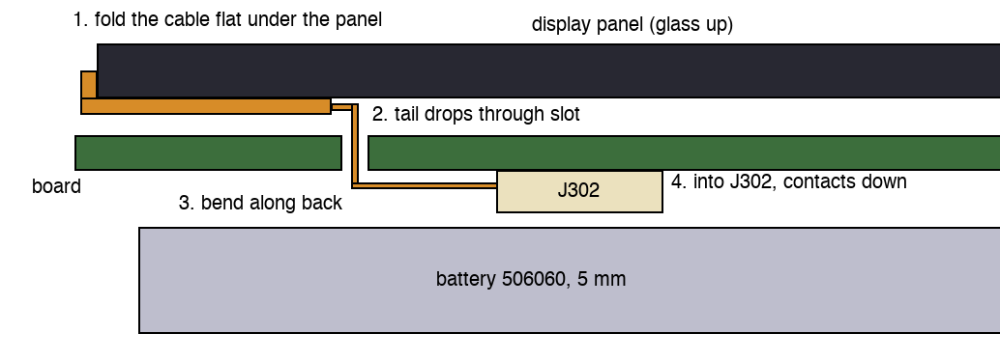

# ltplayer hardware

KiCad 10 project, second board layout. Schematic and 4-layer layout are done
and pass ERC and DRC with schematic parity. Not yet fabricated.


| Sheet | Contents |
| --- | --- |
| Power | USB4105 USB-C (5.1k CC pull-downs, USBLC6 ESD), BQ24074 1S LiPo charger with power path (1 A charge, 1.5 A input), soft power latch, TLV75533 3.3 V, TLV62569 buck to 2.0 V feeding two TPS7A2018 1.8 V LDOs (digital `+1V8`, analog `+1V8A`), battery solder pads plus an optional side-entry JST-PH |
| MCU | STM32U575ZIT6Q (SMPS variant, 2.2 uH on VLXSMPS), 16 MHz crystal for USB DFU, decoupling, BOOT0 pull-down, NRST cap, battery and VBUS sense dividers, ten buttons |
| Peripherals | Hirose DM3AT microSD on SDMMC1 4-bit with 47k pull-ups, Newhaven NHD-2.4-240320AF-CSXP 2.4in IPS panel on a 40-pin FH12 on the back, 2N7002 backlight switch |
| Wireless | ESP32-MINI-1U (Bluetooth Classic A2DP, BLE, 2.4 GHz WiFi) on the back, own TLV75733 3.3 V regulator switched by the MCU, U.FL to a stick-on antenna |
| Audio | Two CS43131 (I2C 0x30 and 0x31), shared 22.5792 MHz 1.8 V oscillator for MCLK, PCA9306 I2C shifter, TXS0102 shifters on I2S, four TMUX4819 output switches, SJ1-3524N 3.5 mm and PJ-4450 4.4 mm jacks on the back |

## Pin map

Kept as close to the current firmware (`src/main.rs`) as possible.

| Function | Pin | Notes |
| --- | --- | --- |
| SDMMC1 D0 D1 D2 D3 CLK CMD | PC8 PC9 PC10 PC11 PC12 PD2 | unchanged |
| SD card detect | PF15 | low = card present |
| SPI1 SCK MOSI | PA5 PA7 | unchanged, panel MISO (SDO) not connected |
| TFT CS DC RST | PD14 PD15 PF12 | unchanged, 4-wire SPI strapped by IM0/IM1/IM2 |
| Backlight | PE11 | TIM1_CH2 PWM into Q301, high = on |
| Buttons up down left right | PE13 PE14 PA3 PA2 | front d-pad, active low with internal pull-up |
| Buttons play/pause back | PE10 PB0 | play/pause moved from PC3 so every button has its own EXTI line |
| Button menu | PE15 | active high, shares the BOOT0 net (see Flashing) |
| Buttons vol+ vol- | PE7 PE8 | right edge SKSC, active low with internal pull-up |
| Power button | PE12 | active high, VSYS through a 100k/200k divider |
| Power hold | PC13 | drive high at boot to keep the regulators on |
| SAI1 FS_A SCK_A SD_A | PE4 PE5 PE6 | |
| DAC INT | PE1 | moved from PE2, which shared an EXTI line with the right button |
| DAC reset control | PE3 | inverted through Q401: low releases reset, high or floating holds it |
| I2C1 SCL SDA | PB8 PB9 | |
| JACK_SEL | PG0 | low = 3.5 mm |
| Output switch enable | PG3 | SW_EN, high turns on all four TMUX4819, low mutes both jacks |
| Jack detect 3.5 mm, 4.4 mm | PG1, PG2 | |
| USB DM DP, VBUS sense | PA11 PA12, PA9 | |
| Battery sense | PA0 | VBAT / 2 |
| BOOT0 | PH3 | 10k to GND, the menu button pulls it to +3V3 |
| ESP32 UART (USART3 TX, RX) | PD8 PD9 | commands and ESP32 firmware updates |
| ESP32 I2S (SAI2_A SCK, SD, FS) | PD10 PD11 PD12 | MCU sends decoded audio to the ESP32 |
| ESP32 EN, BOOT, radio power | PD13 PG13 PG14 | PG14 high turns on the ESP32's 3.3 V regulator |
| HSE | PH0 PH1 | 16 MHz crystal Y201 |

## Power

The slide switch is gone. SW101 pulls `PWR_EN` up from VSYS through D103, which
starts all three regulators. Firmware then drives PC13 high, which holds
`PWR_EN` through D104, so the board stays on after the button is released. To
power off, drive PC13 low. R107 pulls `PWR_EN` down so the board stays off
while the button is up. PE12 reads the button through a divider so it also
works as a normal input while running.

USB power also holds `PWR_EN` through R110 and D105, so a plugged-in board
stays on whatever the firmware does. If the user switches off while it is
plugged in, firmware should turn the screen off and sleep.

The BQ24074 runs the system from USB and charges the battery at the same
time (R103 890 ohm sets 1.0 A, R105 1.1k sets a 1.5 A input limit, R111 10k
stands in for a thermistor). The TLV62569 buck (232k/100k divider, 2.2 uH)
turns the battery into 2.0 V,
and both 1.8 V LDOs run from that, so they only drop 0.2 V instead of 2 V.

### Battery

| Output | Draw from the battery | For 18 h with 20% margin |
| --- | --- | --- |
| 3.5 mm, one DAC | about 20 mA | 0.44 Ah |
| 4.4 mm balanced, two DACs | about 34 mA | 0.73 Ah |
| Bluetooth headphones | about 107 mA | 2.3 Ah |

Screen off, 0.1 mW per channel into wired headphones, from datasheet typicals
(Cirrus Table 3-19 for the DACs, Espressif's measured 101 mA for ESP32 A2DP
streaming). The screen adds about 36 mA. Bluetooth sets the battery:

| Cell | Bluetooth | 4.4 mm | 3.5 mm |
| --- | --- | --- | --- |
| 2000 mAh | about 15 to 16 h | about 50 h | about 85 h |
| 2500 mAh (if the rating is honest) | about 19 to 20 h | about 62 h | about 105 h |

It charges in about 2 to 2.5 hours at 1 A. Measure a real board before buying
cells in bulk.

The cell is a **506060**-size LiPo pouch: 5.0 x 60 x 60 mm bare, about 62 mm
long with its protection board, 3.7 V. Makers rate this size 2000 mAh (for
example DNK, HNF and the Tokopedia/Websong listings of the 505060 and 506060)
and a few sell it as 2500 mAh (Bihuade 506060 on Amazon, with a JST-PH 2.0
plug). Plan on 2000 mAh unless a datasheet shows the higher figure. Buy one
with a protection board (PCM). The BQ24074 has no cell protection of its own.

It lies flat on the back of the board, x -30.5 to +30.5 and y -37 to +25:
between the two bottom screw bosses, and below the two jacks, which sit on
the back along the top edge and are as deep as the battery. Under the cell
the deepest part is the display connector J302 at 2.1 mm, so the cell sits
from Z -2.7 to -7.7. Put a 0.1 mm Kapton sheet between cell and parts and fix
it with thin foam tape. The enclosure needs at least 7.7 mm behind the board
face, plus the foam and a swelling allowance (keep 0.5 mm).

The protection board end faces the bottom. Solder its wires to J103 below the
battery, or for a cell with a JST-PH plug fit J102 next to it (opening to the
right). Check the plug's polarity against J102 pin 1 (VBAT) before
connecting: cheap cells differ.

## Bluetooth and WiFi

The ESP32 sits on the back with its own regulator (U107), which the MCU turns
on with PG14 only when wireless is in use, so wired playback pays nothing for
it. The MCU decodes the music as usual and sends it to the ESP32 over I2S,
and the ESP32 streams it to the headphones over Bluetooth A2DP (SBC codec).
Commands go over USART3. The same chip has 2.4 GHz WiFi.

The module uses an external antenna: a small flexible stick-on antenna on a
U.FL cable, placed behind the screen glass or another non-metal part of the
case, at least about 5 mm from metal. The whole case can be metal. Example
antennas: Molex 146153 (about 40 x 7 mm) or any 2.4 GHz FPC antenna with a
U.FL (IPEX MHF I) plug and a short cable.

The ESP32 has its own firmware. The MCU updates it over USART3 by holding
ESP_BOOT low and pulsing ESP_EN, so flashing the whole device stays USB only.

## Display

Newhaven [NHD-2.4-240320AF-CSXP](https://newhavendisplay.com/2-4-inch-ips-tft-without-touchscreen/):
2.4in IPS, 240x320, ST7789VI, mounted landscape with the picture centred on
the board. 4-wire SPI (IM0 low, IM1 and IM2 high on the board). The panel runs
from +3V3. Its four backlight LEDs run from VSYS through R307 (22 ohm),
switched on the low side by Q301 from PE11. Firmware should scale the PWM
duty with the battery reading on PA0 to keep brightness even.

### Fitting the cable

The cable leaves the panel's left edge. Its first 13 mm are 39 mm wide (the
part with the shielding and small parts on it). Then a 20.5 mm wide, 0.3 mm
thick tail runs another 16.8 mm to the contacts. Newhaven designed it to fold
flat behind the panel, and the board is laid out for that:



1. Fold the cable back under the panel, flat against the panel's back. The
   wide part stays on the panel, the narrow tail sticks out past it.
2. Hold the panel above the board, picture up, and feed the tail straight down
   through the slot (1.2 x 22.5 mm, about 11 mm in from the panel's left
   edge). Only the tail goes through, the wide part never enters the slot. Go
   end first, the 0.3 mm tail drops through the 1.2 mm slot with room to
   spare.
3. Turn the board over. Bend the tail flat against the back toward J302,
   whose opening is 6 mm from the slot.
4. Flip up J302's black actuator, push the tail in until it stops (contacts
   down, toward the board), and press the actuator closed.
5. Turn the board back over and lay the panel down onto the front shell. The
   2 mm of spare length bows in the 1.8 mm gap under the panel.

Nothing taller than an 0603 part sits on the front under the folded cable
(x -33.2 to -21.1). The 1.8 V regulators and the buck sit on the back there.

J302 is a bottom-contact Hirose FH12-40S-0.5SH. After the fold and the turn,
the cable's contacts face the board, and its pin order arrives mirrored, so
panel pin 1 is on J302 pin 40. The schematic is wired that way. The front
shell holds the panel with adhesive.

## Flashing

Flashing is USB only. The STM32's built-in USB DFU bootloader does the work,
so no probe or back plate removal is needed.

1. Hold the menu button and plug in USB. Menu pulls BOOT0 high, so the chip
   starts in its bootloader. Firmware can also jump there from a menu item.
2. Flash: `dfu-util -a 0 -s 0x08000000:leave -D ltplayer.bin`, or use
   STM32CubeProgrammer in USB mode.

There is no debug header. Use `defmt` logging over USB for debugging.

## Audio routing

Four TMUX4819 (one SPDT each, WSON-8 2 x 2 mm, 0.16 ohm) do the routing.
JACK_SEL drives all four SEL pins (low selects SA, high selects SB). SW_EN
(PG3) drives all four EN pins: low turns every switch off, which mutes both
jacks, for example while the DACs start up.

* Low: U406 and U407 pass DAC1 HPOUTA and HPOUTB to the 3.5 mm tip and ring. DAC1 runs in stereo. U408 and U409 are open, so DAC2 is disconnected.
* High: U406 and U407 pass DAC1 to 4.4 mm L+ and L-, U408 and U409 connect DAC2 to R+ and R-. Both DACs run in mono (differential) mode, set by the register sequence in datasheet section 5.12.

Both DAC resets are held low by Q401 until firmware drives PE3 low, and R448
pulls `DAC_RESET` to VSYS, so VP is up before reset releases as the datasheet
requires. HPREFA/HPREFB of both DACs and the jack sleeves share `HP_GND`, a
dedicated In2 trace that joins `GND` only at R453 (0 ohm).

## Board

67.0 x 94.6 mm, 6.15 mm corner radius, which leaves 0.2 mm per side in the
67.4 x 95 enclosure pocket. Four layers:

| Layer | Use |
| --- | --- |
| F.Cu | parts, signals, GND fill |
| In1.Cu | solid GND |
| In2.Cu | +3V3 with a +1V8 island under the DACs and level shifters (notched for the display connector), VSYS and HP_GND traces |
| B.Cu | signals, microSD, display and battery connectors, GND fill |

Rules are in `ltplayer.kicad_pro` and sized for JLCPCB 4-layer: 0.1 mm
track and space minimum, 0.127 mm clearance, 0.45/0.25 mm vias. No via-in-pad
or blind vias.

### Parts for reflow

Every resistor and capacitor is 0603 or bigger (109 at 0603, 7 at 0805), and
so are both inductors. The finest-pitch parts are the two CS43131 DACs (QFN
0.4 mm, no larger package exists) and the parts at 0.5 mm pitch: the
STM32U575 (LQFP-144), the BQ24074 (QFN 3 x 3), the four TMUX4819 (WSON 2 x 2)
and the display connector. Everything else has leads at 0.65 mm or wider:
SSOP-8 level shifters (PCA9306DCTR, TXS0102DCTR), SOT-23 regulators
including the TLV62569 buck, a 3.2 x 2.5 mm crystal and MCLK oscillator
(Epson SG-8018CE class, 1.8 V, 22.5792 MHz). A stencil (0.12 mm) and reflow
handle all of it.
`ltplayer.kicad_dru` relaxes hole clearance inside the USB-C footprint only,
where GCT's land pattern puts the GND pads 0.194 mm from the plastic pegs.

## Mechanical

[ltplayer-mech.dxf](docs/ltplayer-mech.dxf) and
[ltplayer-mech.csv](docs/ltplayer-mech.csv) have the outline, every hole and
the body outlines of the edge parts. Origin at the board centre, +X right,
+Y up, viewed from the front (display side), millimetres.

| Feature | Position | Size |
| --- | --- | --- |
| Corner holes H101 to H104 | (±27.35, ±41.15) | 2.2 mm plated, 4.4 mm GND pad, M2. PCB mount and back plate screws share them |
| Display panel | x -32.41 to +27.50, y -4.30 to +38.50 | 59.91 x 42.80 x 2.55 |
| Picture area | x -24.48 to +24.48, y -1.26 to +35.46 | 48.96 x 36.72, the window, centred |
| Display cable slot | x -20.91 to -19.71, y +6.35 to +27.85 | through the board, rounded ends |
| 3.5 mm jack J401 | x = -15.0, top edge, back | board notch 4.4 wide, 1.4 deep, opening centre Z -2.6 |
| 4.4 mm jack J402 | x = +15.0, top edge, back | body overhangs the edge by 1.6 mm, opening centre Z -3.3 (estimate) |
| USB-C J101 | x = 0, bottom edge, front | |
| microSD J301 | x = +13.5, bottom edge, back | |
| Power, vol+, vol- | x = +31.15, y = +31.5, +17.5, +7.5 | right edge, side push |
| D-pad | centre (0, -24), up (0, -15.5), down (0, -32.5), left (-8.5, -24), right (+8.5, -24) | KMR2, play/pause in the middle |
| Back, menu | (-19, -10), (+19, -10) | KMR2 |
| Battery | x -30.5 to +30.5, y -37 to +25 | back, 61 x 62 x 5.0, Z -7.7 to -2.7 |
| Battery pads J103, JST-PH J102 | (-23.0, -41.0), (-14.5, -41.6) | back, below the battery |
| Display connector J302 | (-9.3, +17.1) | back, opening faces the cable slot |
| ESP32 U501 | (+18.0, -10.5) | back, 13.2 x 13.5 x 2.4, U.FL at its top left corner |

### 3D

`3d/ltplayer-assembly.step` is the board with every part and the display
panel, drawn from its datasheet with the picture area and the folded cable
as separate solids, and the battery as a block. It uses the same origin as the DXF, with +Z toward the
user and the board's back face at Z = 0. `3d/ltplayer-board.step` is the
board alone. Both are build outputs and not in git. Run `scripts/route.sh`, or
only the last block of it, to make them.

| Item | Z (mm) |
| --- | --- |
| Battery back face | -7.7 |
| Back of the 4.4 mm jack (estimate) | -6.6 |
| Back of the 3.5 mm jack | -5.6 |
| Back of the optional JST-PH battery connector | -4.94 |
| Battery front face | -2.7 |
| Back of the ESP32 module | -2.4 |
| Board back face, front face | 0, 1.6 |
| KMR2 button tops | 3.5 |
| Display panel back, glass front | 3.4, 5.95 |

Total from battery back to glass: 13.65 mm (it was 18.75 mm with the jacks
on the front). The panel sits 0.3 mm above the tallest part under it, the
STM32 (LQFP-144, 1.5 mm). Both jacks are on the back, so their pins poke out
of the front: trim them to 1 mm after soldering. The jacks are as deep as the
battery, so they add nothing behind it.

Parts with no model in KiCad's library are plain blocks named `placeholder`:
the three side buttons (1.25 mm tall per Alps), the four TMUX4819 (0.8 mm),
the MCLK oscillator (0.8 mm) and the 4.4 mm jack. KKG publishes no height for
the PJ-4450, so its 6.6 mm block is an estimate.

## Rebuilding the layout

The board is generated from the schematic by scripts. Hand edits in KiCad are
lost on the next run, so change the scripts instead.

```sh
scripts/route.sh   # 5 to 15 minutes
```

| Script | Step |
| --- | --- |
| `geom.py` | shared numbers: outline, DAC cells, plane split, net classes |
| `localize_fp.py` | copies edge-hanging footprints into `ltplayer.pretty` without edge and silk outlines |
| `build.py` | new board from the netlist, anchors the big parts, draws the outline |
| `place_passives.py` | places the rest next to the pin each one serves |
| `rules.py` | design rules and net classes |
| `plane_vias.py` | a via at every GND, +3V3, +1V8, VSYS and HP_GND pad |
| `dsn2l.py` | presents the board to Freerouting as two layers without the plane nets |
| `finish.sh` | imports the route, runs `trunk.py` (VSYS and HP_GND on In2), pours zones, removes leftovers, `nudge.py` (micron misses at stub vias), DRC |
| `mech.py` | the DXF and CSV above |

Needs Freerouting 2.5 and Java (`FREEROUTING` overrides the jar path) and the
KiCad Python at `~/code/pkg/mcp/kicad/venv`.

## Check before ordering

* **Display cable**: J302 is bottom contact with the pin order mirrored (panel pin 1 on J302 pin 40), worked out from Newhaven's drawing. Check with a paper strip cut to the drawing (contacts marked) before ordering. If it comes out the other way, a top-contact FH12A-40S-0.5SH fits the same footprint area.
* **Display slot**: check the cable folds and drops through the 1.2 mm slot without kinking, with the same paper mock-up.
* **Battery**: confirm the real cell measures 61 x 62 x 5 mm or less with its protection board and wires, and the plug polarity matches J102.
* **Jack openings**: the jacks now face out of the top edge just behind the board (centre about Z -2.6 and -3.3). Check the enclosure opening lines up with a real PJ-4450, whose height is still an estimate.
* **MCLK oscillator**: the footprint is a generic 3.2 x 2.5 mm 4-pad oscillator. Pick a 1.8 V 22.5792 MHz part in that size (Epson SG-8018CE, SiTime SiT1602 class) and check its pad map: 1 OE, 2 GND, 3 OUT, 4 VDD.
* **Charger heat**: 1 A from 5 V into a 3.7 V cell burns about 1.3 W in the BQ24074. It throttles itself if it gets hot, so the real charge time may be longer.
* **Antenna**: try the stick-on antenna in the real case before ordering boards. Signal through the screen glass is weaker near the display's metal frame, so test a few spots.
* **ESP32 footprint**: from Espressif's own KiCad library. Check it against the datasheet land pattern.
* **Bluetooth certification**: selling a product that says Bluetooth needs Bluetooth SIG qualification (USD 12,000 for the first product with this design). The module's FCC/CE approval carries over.
* **DFU clock**: AN2606 may let the STM32U575 bootloader run USB without a crystal. If it does, Y201 can stay unpopulated.
* **microSD**: the slot faces the bottom edge on the back. Confirm the card goes in where the enclosure leaves an opening.
* **4.4 mm jack**: the PJ-4450 pin assignment is estimated from the drawing. Confirm against the part.
* **Side buttons**: the SKSC peg hole spacing is scaled from the Alps drawing. Confirm against a part.
* **3.5 mm detect**: the SJ1-3524N tip switch reads through a 1M pull-up, so detect polarity flips against the 4.4 mm jack.
* **DAC RESET** comes from VSYS through R448. Check the VIH spec at low battery.

## Firmware changes

* Drive PC13 high early in boot to hold power, read the power button on PE12. On USB power, sleep instead of releasing PC13.
* PE3 drives reset through an inverter now: low releases both DACs.
* Buttons: up PE13, down PE14, play/pause PE10, vol+ PE7, vol- PE8 (active low). Menu PE15 is active high. DAC_INT moved to PE1.
* Display: landscape (320x240), ST7789VI on 4-wire SPI without MISO, backlight PWM on TIM1_CH2 (PE11) scaled with battery voltage.
* An "update" menu item that jumps to the system bootloader for USB DFU.
* Bluetooth: SAI2 block A as I2S master to the ESP32, USART3 command link, PG14 to power the ESP32, and an ESP32 firmware (ESP-IDF A2DP source) that the MCU can flash over USART3.
* SAI1 pins, the second DAC at 0x31, mono mode switching and the 3.5 mm detect polarity in `src/jack.rs`.
* Output switches: drive PG3 (SW_EN) high to unmute once the DACs are running, low before switching JACK_SEL or powering down.
