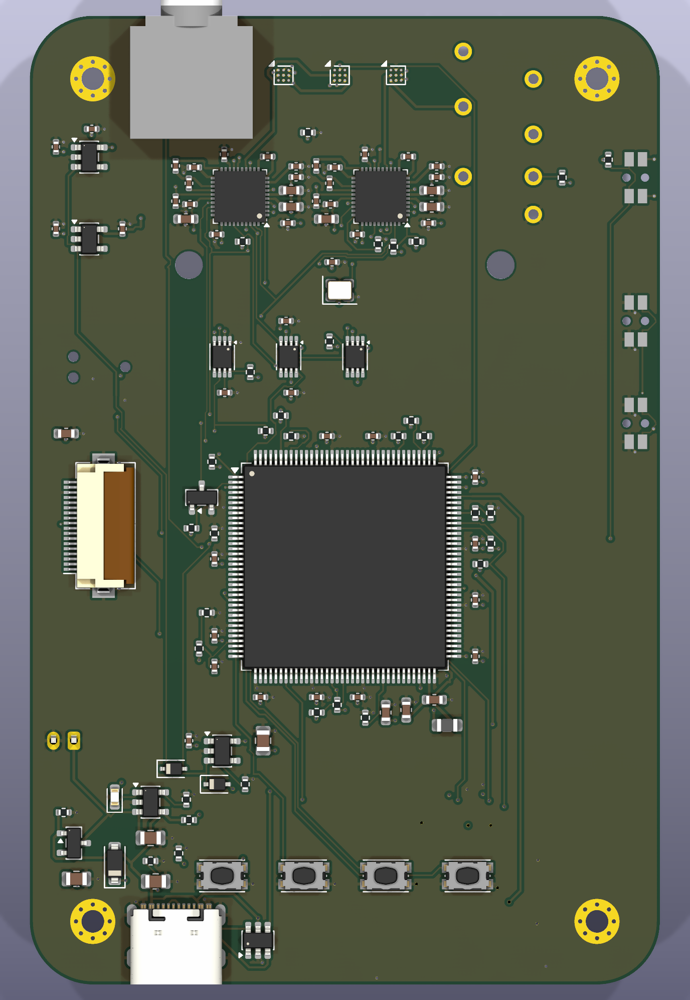

# ltplayer hardware

KiCad 10 project, first board revision. Schematic and 4-layer layout are done
and pass ERC and DRC with schematic parity. Not yet fabricated.



| Sheet | Contents |
| --- | --- |
| Power | USB4105 USB-C (5.1k CC pull-downs, USBLC6 ESD), MCP73831 1S LiPo charger (500 mA via 2k PROG), VBUS/VBAT power path (B5819W + AO3401A), soft power latch, AP2112K 3.3 V, two TPS7A2018 1.8 V LDOs (digital `+1V8`, analog `+1V8A`), JST-PH battery connector |
| MCU | STM32U575ZIT6Q (SMPS variant, 2.2 uH on VLXSMPS), decoupling, BOOT0 pull-down, NRST cap, TC2030 SWD, battery and VBUS sense dividers, seven buttons |
| Peripherals | Hirose DM3AT microSD on SDMMC1 4-bit with 47k pull-ups, EYESPI 18-pin FPC for the Adafruit 4311 |
| Audio | Two CS43131 (I2C 0x30 and 0x31), shared 22.5792 MHz 1.8 V oscillator for MCLK, PCA9306 I2C shifter, TXS0102 shifters on I2S, three TMUX4827 output switches, SJ1-3524N 3.5 mm and PJ-4450 4.4 mm jacks |

## Pin map

Kept as close to the current firmware (`src/main.rs`) as possible.

| Function | Pin | Notes |
| --- | --- | --- |
| SDMMC1 D0 D1 D2 D3 CLK CMD | PC8 PC9 PC10 PC11 PC12 PD2 | unchanged |
| SD card detect | PF15 | low = card present |
| SPI1 SCK MISO MOSI | PA5 PA6 PA7 | unchanged |
| TFT CS DC RST LITE | PD14 PD15 PF12 PE11 | unchanged |
| TFT SDCS TSCS MEMCS | PF14 PF13 PE9 | unchanged, held high |
| Buttons left right play/pause back | PA3 PA2 PC3 PB0 | front KMR2, active low with internal pull-up |
| Buttons vol+ vol- | PE7 PE8 | right edge SKSC, active low with internal pull-up |
| Power button | PE12 | active high, VSYS through a 100k/200k divider |
| Power hold | PC13 | drive high at boot to keep the regulators on |
| SAI1 FS_A SCK_A SD_A | PE4 PE5 PE6 | |
| DAC INT | PE2 | |
| DAC reset control | PE3 | inverted through Q401: low releases reset, high or floating holds it |
| I2C1 SCL SDA | PB8 PB9 | |
| JACK_SEL | PG0 | low = 3.5 mm |
| Jack detect 3.5 mm, 4.4 mm | PG1, PG2 | |
| USB DM DP, VBUS sense | PA11 PA12, PA9 | |
| Battery sense | PA0 | VBAT / 2 |
| BOOT0 | PH3 | 10k to GND |

## Power

The slide switch is gone. SW101 pulls `PWR_EN` up from VSYS through D103, which
starts all three regulators. Firmware then drives PC13 high, which holds
`PWR_EN` through D104, so the board stays on after the button is released. To
power off, drive PC13 low. R107 pulls `PWR_EN` down so the board stays off
while the button is up. PE12 reads the button through a divider so it also
works as a normal input while running.

## Audio routing

JACK_SEL drives all three TMUX4827 SEL pins (low selects SxA, high selects SxB).

* Low: U406 passes DAC1 HPOUTA/HPOUTB to the 3.5 mm tip and ring. DAC1 runs in stereo.
* High: U407 passes DAC1 outputs to 4.4 mm L+ and L-, U408 passes DAC2 outputs to R+ and R-. Both DACs run in mono (differential) mode, set by the register sequence in datasheet section 5.12.

Both DAC resets are held low by Q401 until firmware drives PE3 low, and R448
pulls `DAC_RESET` to VSYS, so VP is up before reset releases as the datasheet
requires. HPREFA/HPREFB of both DACs and the jack sleeves share `HP_GND`, a
dedicated In2 trace that joins `GND` only at R453 (0 ohm).

## Board

61.6 x 94.6 mm, 6.15 mm corner radius, which leaves 0.2 mm per side in the
62 x 95 enclosure pocket. Four layers:

| Layer | Use |
| --- | --- |
| F.Cu | parts, signals, GND fill |
| In1.Cu | solid GND |
| In2.Cu | +3V3 with a +1V8 island under the DACs and level shifters, VSYS and HP_GND traces |
| B.Cu | signals, microSD, battery and SWD connectors, GND fill |

Rules are in `ltplayer.kicad_pro` and sized for JLCPCB 4-layer: 0.1 mm
track and space minimum, 0.127 mm clearance, 0.45/0.25 mm vias. The three
TMUX4827 DSBGA parts need 0.3/0.15 mm via-in-pad (filled and capped, POFV).
`ltplayer.kicad_dru` relaxes hole clearance inside the USB-C footprint only,
where GCT's land pattern puts the GND pads 0.194 mm from the plastic pegs.

## Mechanical

[ltplayer-mech.dxf](docs/ltplayer-mech.dxf) and
[ltplayer-mech.csv](docs/ltplayer-mech.csv) have the outline, every hole and
the body outlines of the edge parts. Origin at the board centre, +X right,
+Y up, viewed from the front (display side), millimetres.

| Feature | Position | Size |
| --- | --- | --- |
| Corner holes H101 to H104 | (±24.65, ±41.15) | 2.2 mm plated, 4.4 mm GND pad, M2. PCB mount and back plate screws share them |
| Display standoffs H105, H106 | (±15.24, +22.96) | 2.7 mm, M2.5 |
| Display breakout (Adafruit 4311) | x ±17.78, y +25.5 to -33.56 | 35.56 x 59.055 |
| 3.5 mm jack J401 | x = -15.0, top edge | board notch 4.4 wide, 1.4 deep |
| 4.4 mm jack J402 | x = +15.0, top edge | body overhangs the edge by 1.6 mm |
| USB-C J101 | x = -16.5, bottom edge, front | |
| microSD J301 | x = +11.0, bottom edge, back | |
| Power, vol+, vol- | x = +28.45, y = +31.5, +17.5, +7.5 | right edge, side push |
| Back, left, play/pause, right | y = -36.7, x = -12, -4, +4, +12 | front, KMR2 |
| Battery connector J102 | (-26.5, -23.5) | back, JST-PH vertical |
| SWD J201 | (-24.0, +13.0) | back, TC2030-NL |
| Charge LED D101 | (-22.5, -29.0) | front |

## Rebuilding the layout

The board is generated from the schematic by scripts. Hand edits in KiCad are
lost on the next run, so change the scripts instead.

```sh
scripts/route.sh   # about 12 minutes
```

| Script | Step |
| --- | --- |
| `geom.py` | shared numbers: outline, DAC cells, plane split, net classes |
| `localize_fp.py` | copies edge-hanging footprints into `ltplayer.pretty` without edge and silk outlines |
| `build.py` | new board from the netlist, anchors the big parts, draws the outline |
| `place_passives.py` | places the rest next to the pin each one serves |
| `rules.py` | design rules and net classes |
| `plane_vias.py` | a via at every GND, +3V3, +1V8, VSYS and HP_GND pad |
| `dsn2l.py` | presents the board to Freerouting as two layers without the plane nets |
| `finish.sh` | imports the route, runs `trunk.py` (VSYS and HP_GND on In2), pours zones, removes leftovers, DRC |
| `mech.py` | the DXF and CSV above |

Needs Freerouting 2.5 and Java (`FREEROUTING` overrides the jar path) and the
KiCad Python at `~/code/pkg/mcp/kicad/venv`.

## Check before ordering

* **Display connector**: J302 pin order is reversed against the KiCad FH12 footprint to match Adafruit's EYESPI numbering. Confirm with the actual cable, and which side of the board it reaches.
* **microSD**: the slot faces the bottom edge on the back. Confirm the card goes in where the enclosure leaves an opening.
* **4.4 mm jack**: the PJ-4450 pin assignment is estimated from the drawing. Confirm against the part.
* **Side buttons**: the SKSC peg hole spacing is scaled from the Alps drawing. Confirm against a part.
* **Via-in-pad**: confirm JLCPCB accepts 0.15 mm drills with POFV under the TMUX4827.
* **Height under the display**: the tallest parts under it are the oscillator and the 0805 parts. Check the standoff length.
* **3.5 mm detect**: the SJ1-3524N tip switch reads through a 1M pull-up, so detect polarity flips against the 4.4 mm jack.
* **DAC RESET** comes from VSYS through R448. Check the VIH spec at low battery.

## Firmware changes

* Drive PC13 high early in boot to hold power, read the power button on PE12.
* PE3 drives reset through an inverter now: low releases both DACs.
* Add the vol+ and vol- buttons on PE7 and PE8.
* SAI1 pins, the second DAC at 0x31, mono mode switching and the 3.5 mm detect polarity in `src/jack.rs`.
